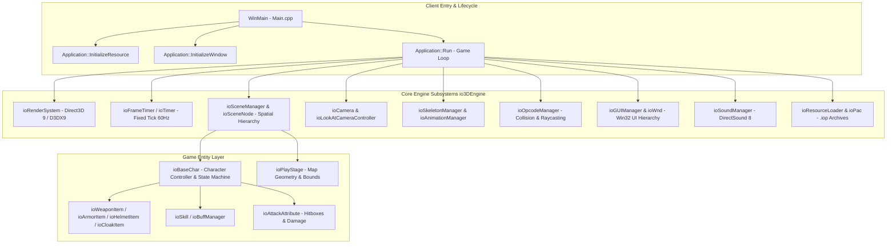
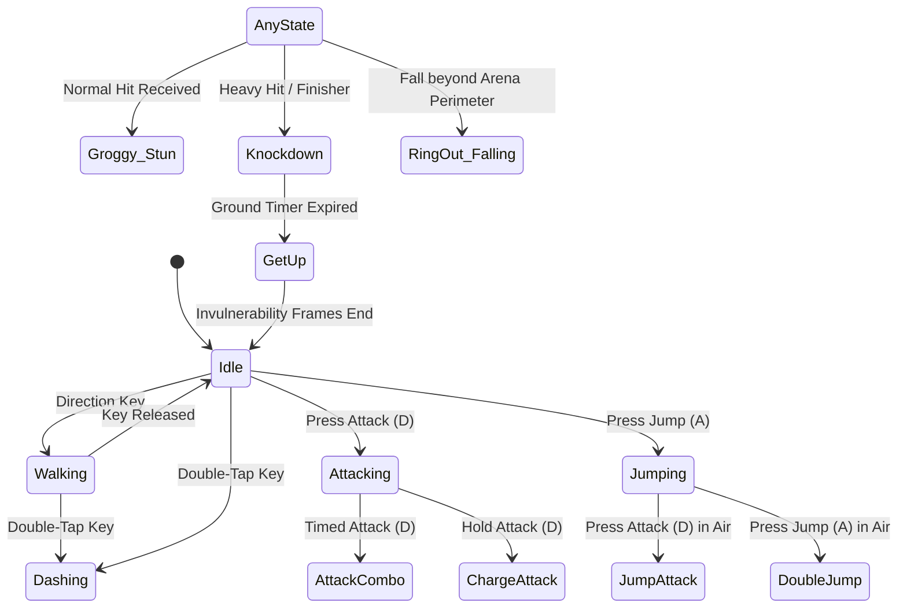

# Client & Engine Architecture Audit: NOVERA Legacy

## 1. Overview & Architecture Diagram

The legacy Lost Saga client is a 32-bit Windows desktop application written in C++ (MSVC 2010), built upon IO Entertainment's proprietary **`io3DEngine`** framework, Direct3D 9, and the Win32 API.



---

## 2. Main Entry Points & Application Lifecycle

### 2.1 Entry Point (`Main.cpp`)
The main execution begins in the standard Win32 `WinMain`:
```cpp
int WINAPI WinMain(HINSTANCE hInstance, HINSTANCE hPrevInstance, LPSTR lpCmdLine, int nShowCmd);
```
Key initialization sequence:
1. **Log Subsystem**: Initializes `LOG.OpenLog(0, "log/game.log")` via `LSLog.lib`.
2. **Resource Loading**: Calls `pApp->InitializeResource()`, initializing `g_ResourceLoader`.
3. **Window Creation**: Calls `pApp->InitializeWindow(hInstance)`, registering the Win32 window class and creating the main window (`HWND`).
4. **Execution Run**: Invokes `pApp->Run()` executing the primary game loop.
5. **Teardown & Cleanup**: Handles window destruction and draining pending Windows messages (`PeekMessage` / `GetMessage` pump).

### 2.2 Resource Loading (`ProcessOptions`)
The client can run in two modes:
* **Packed Mode (`USE_PACK`)**: Mounts encrypted `.iop` pack files into virtual paths:
  * `rs.iop` mounted at root `""` (contains core textures, models, sound, and shaders).
  * `map.iop` mounted at `"_map"` (contains level terrain, collision geometry, and skyboxes).
* **Unpacked Mode**: Directly streams loose assets from the directory filesystem for rapid developer iteration.

---

## 3. Game Loop Architecture

The client runs an asynchronous Win32 message-driven game loop governed by `ioFrameTimer`:

```cpp
int Application::Run()
{
    MSG msg;
    while (true)
    {
        if (PeekMessage(&msg, NULL, 0, 0, PM_REMOVE))
        {
            if (msg.message == WM_QUIT)
                break;
            TranslateMessage(&msg);
            DispatchMessage(&msg);
        }
        else
        {
            if (m_bIsActive)
            {
                m_Timer.UpdateTimer();
                ProcessFrame(m_Timer.GetTimePerFrame());
                RenderFrame();
            }
            else
            {
                ::SleepEx(1, FALSE); // Prevent 100% CPU starvation when unfocused
            }
        }
    }
    return (int)msg.wParam;
}
```

### Key Loop Characteristics
* **Target Frame Rate**: Standard tick rate at 60 FPS (16.67ms per frame).
* **Physics & State Updates**: Fixed delta time accumulator decoupling rendering interpolation from physical state resolution.
* **Focus Handling**: Drops to `SleepEx(1)` when unfocused to minimize background CPU utilization.

---

## 4. Rendering Engine Subsystem (`ioRenderSystem`)

### 4.1 Graphics API & Dependencies
* **API Target**: Direct3D 9.0c (June 2010 DirectX SDK).
* **Headers**: `<d3d9.h>`, `<d3dx9.h>`, `<d3dx9math.h>`.
* **Shading Pipeline**: Fixed-Function Pipeline (FFP) combined with custom HLSL Pixel Shaders (ps_2_0 / ps_3_0) and Vertex Shaders (vs_2_0 / vs_3_0).
* **Buffers**: Dynamic vertex buffers (`ioVertexBufferManager`) and index buffers (`ioIndexBufferManager`) for skinned characters and batch-rendered level geometry.

### 4.2 Scene Hierarchy & Spatial Structure
* **Scene Graph**: Directed acyclic graph (`ioSceneManager`, `ioSceneNode`) containing hierarchical transforms for world entities, characters, props, and visual effects.
* **Sky Rendering**: Hemispherical/spherical dome rendering (`ioSkyDome`) with distance fog and depth-buffer bypass.
* **Particle & VFX System**: Billboarded particle emitter (`ioParticleSystem`), mesh trails (`ioMeshTrailer`), and 2D/3D composite effect nodes (`ioUI3DEffectRender`).

---

## 5. Input Subsystem

### 5.1 Architecture & Polling
* **Input Interfaces**: DirectInput 8 and Win32 `WM_KEYDOWN` / `WM_KEYUP` / `WM_MOUSEMOVE` message capture.
* **Key Mapping**: Configurable key bindings defined in `sp2_key_info.ini.iop`.
* **Double-Tap Engine**: Hardware-timer tracked key states measuring time delta between consecutive press events (threshold default ~200ms) to trigger dashing or evasion states.

---

## 6. Camera Subsystem (`ioCamera` & Controllers)

* **Controller Class**: `ioLookAtCameraController`.
* **Behavior**:
  * Orbits around target player character entity (`ioBaseChar`).
  * Fixed spring-damper camera smoothing on position and yaw/pitch rotation.
  * Raycast-based camera occlusion: sweeps from look-at target to ideal camera position using the collision mesh; pulls the camera forward when occluded by world geometry to prevent geometry clipping.

---

## 7. Skeletal Animation System

* **Managers**: `ioSkeletonManager`, `ioAnimationManager`, `ioAnimationEventManager`.
* **Bone Hierarchy**: Bipedal skeleton structure (`ioBiped`, `ioSkeleton`) with hierarchical matrix transformations.
* **Blending & Layers**:
  * Base layer: Movement cycles (Idle, Run, Dash, Jump).
  * Action layer: Attack animations, hit reactions, and skill gestures.
* **Animation Event Triggers**: Frames within an animation file register event triggers:
  * Hitbox activation/deactivation frames.
  * Footstep audio triggers.
  * Weapon trail and particle spawn frames.
  * Cancel windows allowing combo chaining.

---

## 8. Character Controller & State Machine (`ioBaseChar`)

The core character logic is implemented as an explicit hierarchical finite state machine (FSM):



---

## 9. Physics & Collision Detection (`Opcode`)

* **Collision Library**: Pierre Terdiman's **Opcode** library (`ioOpcodeManager`, `ioOpcodeShape`).
* **World Geometry**: Bounding Volume Hierarchies (AABB Trees) constructed over static map triangle meshes.
* **Entity Collision**:
  * Character-to-World: Cylinder/Capsule swept against map collision meshes.
  * Character-to-Character: Cylinder pushing and separation constraints.
  * Weapon Hitbox: Oriented Bounding Boxes (OBB) or sphere sweeps checked against enemy hurtbox capsules.
* **Ring-Out Bounds**: Bounding trigger volumes located outside arena platform boundaries; crossing triggers the falling death state.

---

## 10. User Interface (UI) Framework (`ioGUIManager`)

* **Windowing**: Custom tree-structured GUI hierarchy (`ioWnd`, `ioButton`, `ioScroll`, `ioEdit`, `ioMovingWnd`).
* **Texture Storage**: High-density sprite sheets packaged in DDS/BMP format with XML metadata definitions (`uiimageset.xml`).
* **Text Rendering**: Windows GDI+ (`GdiPlus.h`) and Win32 font rendering (`ioFontManager`) for localized text rendering.
* **Event Dispatching**: Mouse clicks, hover effects, and keyboard focus are managed centrally by `ioGUIManager`.

---

## 11. Audio Subsystem (`ioSoundManager`)

* **API**: DirectSound 8 (`dsound.h`).
* **Format**: Uncompressed PCM WAV for low-latency SFX; MP3 streams for background music (BGM).
* **3D Positional Audio**: Calculates volume attenuation, pan, and Doppler shifts based on listener camera orientation and sound emitter world coordinates.

---

## 12. Technical Debt & Modernization Obstacles

1. **32-Bit Pointer Model (`x86`)**: Entire architecture depends on 32-bit pointer arithmetic and memory limits (2GB virtual address space).
2. **DirectX 9 Obsolescence**: Direct3D 9 is deprecated on modern Windows systems and completely unsupported on mobile OS (Android/iOS) and modern consoles.
3. **Win32 Message Coupling**: Input, windowing, and rendering are tightly intertwined with the Win32 API, preventing straightforward cross-platform compilation.
4. **Binary Library Dependencies**: Precompiled closed-source libraries (`LSLog.lib`, `io3DEngine.lib`, `TownPortal.lib`, `CrashFind.lib`, `ioPac.lib`) lack portable source code.
