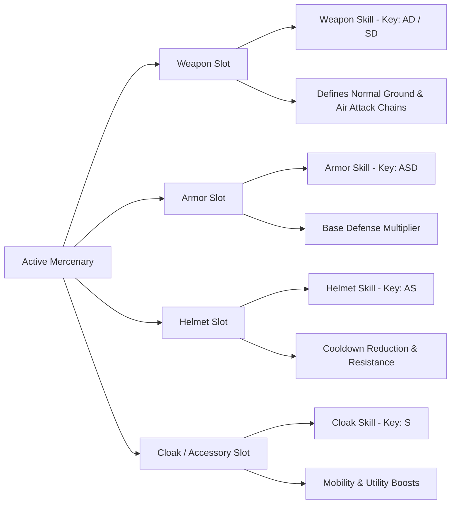
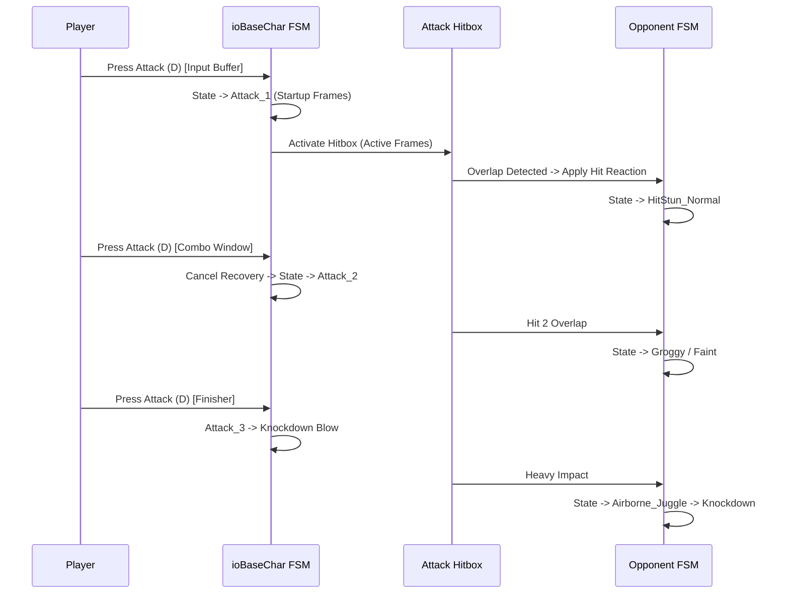

# Gameplay Systems Audit: NOVERA Legacy (Lost Saga)

## 1. Overview & Core Gameplay Philosophy

*Lost Saga* is an arcade 3D brawler fighting game characterized by:
1. **Modular 4-Piece Equipment System**: Every character is composed of a Weapon, Armor, Helmet, and Cloak/Trinket.
2. **Hero Swapping**: Players can switch between multiple mercenaries mid-combat.
3. **Drop-on-Death / Drop-on-Damage**: Taking heavy damage or being defeated knocks equipment off the character into the arena, allowing opponents or teammates to pick it up.
4. **Aerial Juggling & Ring-Out**: Knocking opponents off arena ledges or maintaining aerial juggle combos before recovery.

---

## 2. Hero & Character Definitions

### 2.1 Hero Architecture
Heroes are defined in configuration files parsed from `sp2_etcitem_info.ini.iop` and mercenary folders (`config/mercenary/{hero_id}/{hero_id}_item.ini.iop`):

```ini
[mercenary_info]
mercenary_code = 1
name = Shadow Assassin
class_type = MELEE
gender = MALE_FEMALE_SELECTABLE
base_hp = 1000.0
base_speed = 350.0
dash_type = DOUBLE_TAP_ROLL
jump_type = DOUBLE_JUMP
```

### 2.2 Hero Archetypes
Heroes are divided into standard tactical roles:
* **Melee**: High burst combo damage, rapid attack chains, ground recovery tech (e.g., Shadow Assassin, Iron Knight).
* **Ranged**: Projectile attacks, sniping mechanics, zoning capabilities (e.g., Robin Hood, Space Soldier).
* **Magic**: Area of Effect (AoE) spells, crowd control, charging gauges (e.g., Fire Mage, Ice Mage).
* **Special**: Unique movement or summoning mechanics (e.g., Captain Hook with explosive barrels, Taekwon Master).

---

## 3. Equipment & Modular Gear System

Every active character entity possesses 4 distinct equipment slots:



### 3.1 Gear Properties & In-Game Mechanics
* **Weapon**: Dictates the primary attack strings, charge attacks, counter-attacks, and the weapon skill (default input: `A + D`).
* **Armor**: Dictates character defensive armor stats and the body skill (default input: `A + S + D`).
* **Helmet**: Dictates headgear visuals, resistance stats, and helmet skill (default input: `A + S`).
* **Trinket / Cloak**: Dictates back accessory visuals and accessory skill (default input: `S + D` or `S`).

### 3.2 Gear Dropping & Stealing
* **Drop Condition**: When a hero reaches critical health (0 HP) or suffers a specific disarm debuff, equipment items fly off the character into the physical arena.
* **Pickup Mechanic**: Any player (friend or foe) walking over a dropped gear item can press the interaction key (`S` or context) to equip it, gaining that piece's skill and stats temporarily.
* **Stat Penalty**: Stripped heroes lose corresponding skills, animations, and suffer increased damage penalties until picking up replacement gear or respawning.

---

## 4. Skill System & Gauge Mechanics

* **Gauge Accumulation**: Every skill has a maximum cooldown gauge (typically 0 to 100).
* **Charging Modes**:
  1. *Passive Regeneration*: Slowly fills over time (e.g., 2-5 points/sec).
  2. *Active Combat*: Fills faster when dealing damage or taking hits.
  3. *Charge State*: Manual charging by holding key combinations.
* **Skill Priority & Super Armor**:
  * Level 1: Normal skill (can be interrupted by basic attacks).
  * Level 2: Super Armor (resists basic hit stuns, interrupted only by knockbacks).
  * Level 3: Invulnerability (immune to all incoming damage and crowd control during startup frames).

---

## 5. Locomotion & Movement Mechanics

### 5.1 Directional Movement
* 8-way directional movement mapped to WASD / Arrow keys.
* Fixed acceleration curve with sharp stopping friction allowing precise spacing.

### 5.2 Double-Tap Movement (Dash / Roll)
* Double-tapping a directional key within the threshold window (`< 220ms`) transitions the state machine to `DASH` or `ROLL`:
  * **Sprint Dash**: Continuous forward sprint with high velocity until key release.
  * **Tumble Roll**: Invulnerable rolling frames (i-frames) allowing projectile dodging and repositioning.
  * **Dash Attack**: Pressing the attack button (`D`) while dashing executes a unique Dash Attack (e.g., shoulder tackle, trip sweep, sliding kick).

### 5.3 Jump & Air Control
* **Initial Jump Impulse**: Upward vertical velocity applied instantly on jump key press (`A`).
* **Air Mobility**: Players retain partial horizontal velocity steering while airborne.
* **Double Jump / High Jump**: Specific heroes can press `A` in mid-air to execute a second jump with renewed vertical velocity.
* **Air Dash**: Tapping direction twice in mid-air initiates an air-dash.

---

## 6. Combat Chaining, Combos, and Frame Mechanics



### 6.1 Attack Types
* **Light Attack String**: Sequential tapping of `D` (e.g., `D-D-D-D`). Cancel windows allow immediate chaining into skills or dashes.
* **Hold / Charge Attack**: Holding `D` charges a gauge to trigger heavy guard-breaking strikes, launcher hits, or ranged stances.
* **Jump Attack**: Pressing `D` in the air executes a downward spike or horizontal air attack.

### 6.2 Combo Chaining Rules
* **Input Buffering**: Up to 2 inputs can be queued during the active and recovery frames of an attack.
* **Cancel Windows**: Certain attacks have cancel windows allowing a player to cancel recovery frames into jump, dash, or skill execution.
* **Guard Mechanics**: Holding Guard (`S`) shields against front-facing attacks. Continuous attacks deplete the guard threshold, leading to Guard Break.

---

## 7. Hit Detection, Damage, and Crowd Control (CC)

### 7.1 Hitbox vs Hurtbox
* **Hitboxes**: Oriented Bounding Boxes (OBB) spawned at weapon bones during active animation frames.
* **Hurtboxes**: Skeletal capsules attached to torso, head, and limbs of the target.
* **Collision Check**: Evaluated every physical sub-step (60Hz) using Opcode tree intersection.

### 7.2 Hit Reactions & States
1. **Normal Stun**: Minor flinch; brief frame disadvantage, player recovers standing.
2. **Groggy / Faint**: Extended stagger where opponent can input a directional mash to recover faster.
3. **Knockdown (Ground State)**: Opponent falls to the floor. Most attacks pass through except specific "down-hit" ground attacks.
4. **Air Juggle (Airborne State)**: Opponents struck by launchers are launched into the air. Hits received while airborne reset fall velocity, allowing juggling combos.
5. **Blow-Away / Wall Bounce**: Heavy horizontal knockback. Impacting arena walls causes a wall bounce allowing extended combos; falling off ledge triggers ring-out.

### 7.3 Damage Calculation Formula
$$\text{Damage Dealt} = \left(\text{Base Weapon Power} \times \text{Skill Multiplier} - \text{Target Armor Defense}\right) \times \text{Damage Type Factor}$$

* **Drop-Gear Damage Threshold**: When accumulated damage reaches 100% (HP = 0), a massive knockback is applied and gear pieces are dislodged.

---

## 8. Character Switching (Tag-Team Mechanic)

* **Key Input**: Number keys (`1` through `8`) or wheel selection switch the active mercenary.
* **Switch Conditions**:
  * Can switch during `IDLE`, `WALK`, or `RUN`.
  * Cannot switch during active hit stun, knockdown, or mid-skill animation.
* **Tag Cooldown**: Switching activates a global tag cooldown (typically 5 to 10 seconds) preventing continuous mercenary spamming.
* **Health Persistence**: Each mercenary in the player's barracks maintains its own independent HP pool or shares an aggregate team life bar depending on the game mode.
