# License & Intellectual Property (IP) Audit

## 1. Executive Summary & Legal Caution

> [!CAUTION]
> **CRITICAL LEGAL NOTICE:**
> The original source code, compiled binaries, character designs, 3D models, textures, sound effects, musical scores, and database definitions of *Lost Saga* are the exclusive intellectual property of **IO Entertainment Co., Ltd.**, **WeMade Entertainment Co., Ltd.**, and their respective licensees/successors (such as **Valofe Co., Ltd.** and **Gravity Corp.**).
> 
> The presence of open-source repository wrappers, community private-server setups, or open-source licenses (e.g. MIT, GPL) applied by community contributors **DOES NOT** grant legal ownership, commercial distribution rights, or trademark authorization over original *Lost Saga* assets.
> 
> Any commercial game project derived from or inspired by *Lost Saga* **MUST UTILIZE A CLEAN-ROOM RE-IMPLEMENTATION** for all code, shaders, art assets, audio, and branding.

---

## 2. Intellectual Property Boundaries & Audit Scope

### 2.1 Trademarks & Branding
* **"Lost Saga"** is a registered trademark of **Valofe Co., Ltd.** / **IO Entertainment Co., Ltd.**
* Character names (e.g., *Shadow Assassin*, *Robin Hood*, *Iron Knight*, *Fire Mage*, *Taekwon Master*, *Grim Reaper*), hero lore, and promotional branding are proprietary.
* **Obligation**: No commercial project may use the trademark "Lost Saga" or identical hero lore, names, or logos.

### 2.2 Client Assets & Resource Packages (`.iop`)
* Files such as `rs.iop`, `map.iop`, `sp2_etcitem_info.ini.iop`, `*_item.ini.iop`, and UI texture sheets contain binary copyrighted assets:
  * 3D Meshes (`.mesh`, `.skin`, skeleton hierarchies)
  * Textures (`.dds`, `.tga`, `.bmp`)
  * Sound effects and soundtrack (`.wav`, `.mp3`)
  * UI skin elements and icon sprite sheets
* **Ownership**: Proprietary / Leaked / Reverse-engineered.
* **Redistribution Rights**: **STRICTLY PROHIBITED**. These assets cannot be bundled, distributed, or commercialized.

### 2.3 Server Components & SQL Databases
* Server daemon binaries (`ls_mainsvr.exe`, `ls_gamesvr.exe`, `ls_relaysvr.exe`, `ac_dbagentsvr.exe`, `ac_billingsvr.exe`) and database schema definitions (`LosaGame.sql`, stored procedures) originate from internal corporate source leaks.
* Community git repositories frequently add MIT or unlicense tags to their wrapper scripts, but the underlying core logic and schemas remain proprietary.

---

## 3. Comprehensive License Matrix

| Component / Subsystem | Upstream Provenance | Detected / Applicable License | Commercial Use Permitted? | Modification Permitted? | Key Legal Obligations & Restrictions | Status & Risk Level |
| :--- | :--- | :--- | :--- | :--- | :--- | :--- |
| **Original Lost Saga Client (C++ Win32)** | IO Entertainment / WeMade | Proprietary Commercial (No License) | **NO** | Reverse-engineering only under strict fair-use / research | Leaked proprietary source; no redistribution permitted | 🔴 **CRITICAL RISK** (Must not be used in commercial shipping builds) |
| **Original io3DEngine Framework** | IO Entertainment | Proprietary Commercial (No License) | **NO** | Research/Analysis only | Proprietary 3D engine; full copyright claims apply | 🔴 **CRITICAL RISK** (Must be replaced) |
| **DirectX 9 SDK (June 2010)** | Microsoft Corporation | Microsoft SDK EULA | Restricted (Windows OS target only) | No | Bound to Windows runtime; prohibited on non-Windows without emulation | 🟡 **RESTRICTED** (Platform-locked to Windows) |
| **Opcode Collision Library (v1.3)** | Pierre Terdiman | LGPL 2.1 / Custom zlib-style | Conditionally Yes (if LGPL adhered to or zlib version used) | Yes | If LGPL 2.1: must dynamically link or provide object files for relinking | 🟢 **REUSABLE** (Standard open physics lib) |
| **Boost C++ Libraries (v1.4x - 1.5x)** | Boost Community | Boost Software License 1.0 | **YES** | Yes | Permissive license; attribution required in documentation | 🟢 **LEGALLY COMPLIANT** |
| **DirectSound / Win32 / GDI+ APIs** | Microsoft Corporation | Windows SDK Proprietary | Windows deployment only | No | Bound to Microsoft platform libraries | 🔴 **NON-PORTABLE** (Incompatible with Android/Linux) |
| **Character Models & 3D Meshes (.mesh)** | IO Entertainment | Proprietary Commercial | **NO** | No | Leaked game assets; severe copyright violation if redistributed | 🔴 **PROHIBITED** (Must create original 3D models) |
| **Game Audio & Soundtrack (.wav, .mp3)** | IO Entertainment / Sound Designers | Proprietary Commercial | **NO** | No | Proprietary audio recordings; unauthorized usage illegal | 🔴 **PROHIBITED** (Must commission original audio) |
| **UI Sprite Sheets & DDS Icons** | IO Entertainment | Proprietary Commercial | **NO** | No | Proprietary UI designs and raster assets | 🔴 **PROHIBITED** (Must design original UI) |
| **Server Daemons (mainsvr, gamesvr)** | IO Entertainment | Proprietary Commercial | **NO** | Educational analysis only | Proprietary backend binaries; no license granted | 🔴 **CRITICAL RISK** (Must rewrite modern backend) |
| **MSSQL Database Schemas (LosaGame.sql)**| IO Entertainment | Proprietary Commercial | **NO** | Conceptual reference only | Proprietary database schema layout and stored procedures | 🔴 **PROHIBITED** (Must design original schema) |
| **Community Tools (LSTS-Socket-Modules)**| LSFDC / Community | MIT License | **YES** (for wrapper code only) | Yes | MIT attribution required; packet specification itself is reverse-engineered | 🟡 **CONDITIONAL** (Safe to study protocol concept) |
| **Community Web Tools (losaweb / losadb)**| LSFDC / Community | MIT License | **YES** (code only) | Yes | Open-source Next.js/Hono implementation | 🟢 **CLEAN IMPLEMENTATION** (Usable as reference) |

---

## 4. Reusability Assessment: What Can and Cannot Be Used

```mermaid
graph TD
    A[Lost Saga Ecosystem] --> B[Proprietary Layer]
    A --> C[Conceptual Mechanics]
    A --> D[Open Community Tools]

    B --> B1[Original C++ Source Code]
    B --> B2[io3DEngine.lib & LSLog.lib]
    B --> B3[All 3D Meshes, Textures, Audio]
    B --> B4[Server Binaries & LosaGame.sql]
    style B fill:#ffcccc,stroke:#ff0000,stroke-width:2px
    style B1 fill:#ffe6e6,stroke:#ff0000
    style B2 fill:#ffe6e6,stroke:#ff0000
    style B3 fill:#ffe6e6,stroke:#ff0000
    style B4 fill:#ffe6e6,stroke:#ff0000

    C --> C1[4-Piece Equipment System Concept]
    C --> C2[Ground / Aerial Attack Chains]
    C --> C3[Air Juggle & Ring-Out Combat Rules]
    C --> C4[Character Swap Cooldown Paradigm]
    style C fill:#ccffcc,stroke:#00aa00,stroke-width:2px
    style C1 fill:#e6ffe6,stroke:#00aa00
    style C2 fill:#e6ffe6,stroke:#00aa00
    style C3 fill:#e6ffe6,stroke:#00aa00
    style C4 fill:#e6ffe6,stroke:#00aa00

    D --> D1[TypeScript Protocol Emulators]
    D --> D2[LosaWeb Next.js Management Panels]
    D --> D3[Mathematical Formulas for Knockback / Physics]
    style D fill:#cceeff,stroke:#0066cc,stroke-width:2px
    style D1 fill:#e6f2ff,stroke:#0066cc
    style D2 fill:#e6f2ff,stroke:#0066cc
    style D3 fill:#e6f2ff,stroke:#0066cc
```

### 4.1 What CANNOT Be Legally Reused
1. **Source Code**: No code from `io3DEngine`, `LSClientNew`, or `ls_gamesvr` can be copied or embedded into a commercial product.
2. **Binary Assets**: All `.iop` packages, 3D character skeletons, animations, textures, audio files, and UI bitmaps must be completely excluded from the project repository.
3. **Trademarks & Copyrighted Lore**: Hero lore, character identity art, specific naming conventions, and logos cannot be utilized.

### 4.2 What CAN Be Legally Developed (Clean-Room Re-implementation)
1. **Game Mechanics**: Under international intellectual property law (including US and EU copyright frameworks), **game mechanics, rules, and mathematical combat formulas cannot be copyrighted** (Idea-Expression Dichotomy). The concept of a 4-gear modular equipment brawler with directional dashing, air-juggling, ring-out bounds, and tag-team hero switching can be freely implemented from scratch.
2. **Original Engine Implementation**: Developing a modern client in Unity, Unreal Engine 5, Godot, or native C++/Vulkan that reproduces the responsiveness and combo mechanics cleanly.
3. **Modern Backend Architecture**: Writing a greenfield authoritative backend using Go, Rust, or Node.js/TypeScript that handles lobby matchmaking, state synchronization, and rooms with zero legacy proprietary code.

---

## 5. Recommended IP Risk Mitigation Strategy

1. **Strict Clean-Room Separation**:
   Establish a strict boundary between research/reverse-engineering activities and production engineering. Maintain clean documentation specifications so developers writing production code are not copying proprietary lines of code.
2. **Original Asset Pipeline**:
   All 3D character models, weapon meshes, visual effects (VFX), user interfaces, and sound effects must be created in-house or purchased under verified commercial royalty-free licenses.
3. **Unique Brand Identity**:
   Establish an original title, universe, character roster, and lore completely distinct from *Lost Saga*.
