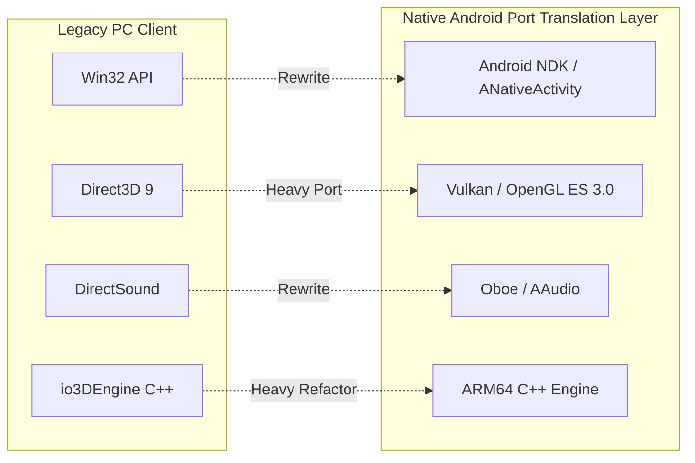
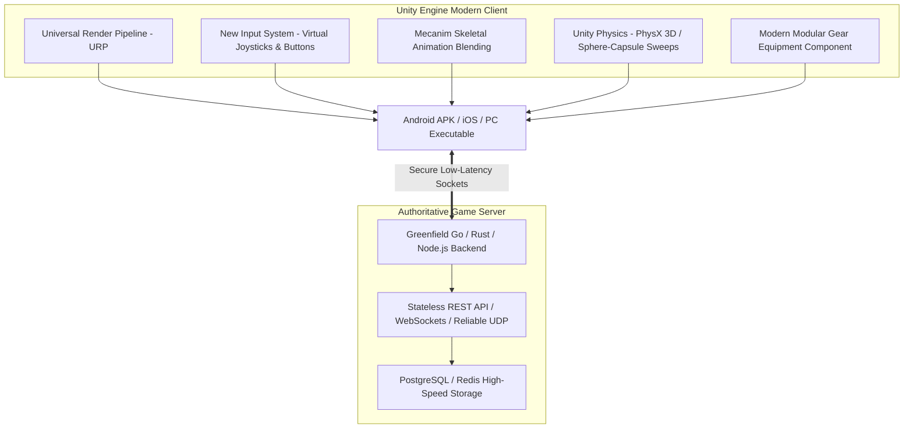

# Mobile Porting Feasibility: PC-to-Android Architecture Evaluation

## 1. Executive Summary

This study evaluates the technical and legal feasibility of adapting the *Lost Saga* game architecture from legacy Windows PC desktop environments to modern mobile platforms (specifically Android/ARM64).

> [!IMPORTANT]
> **Adherence to Engineering Governance**:
> In accordance with our mandate, **no claim of Android compatibility is made without an actual compiled build and verified runtime execution test on physical hardware**. This evaluation assesses the structural feasibility across three distinct engineering options.

---

## 2. Architectural Comparison Matrix

| Evaluation Dimension | Option A: Native C++ Engine Port (Android NDK) | Option B: Unity Client Clean-Room Rewrite | Option C: Hybrid Architecture (Clean Backend + Modern Client) |
| :--- | :--- | :--- | :--- |
| **Architectural Concept** | Port `io3DEngine` and `LSClientNew` C++ codebase to Android NDK via POSIX wrappers. | Complete clean-room client rewrite in Unity (C#) targeting Android/iOS/PC with original assets. | Retain conceptual protocol and mathematical formulas; build clean-room client & modern backend. |
| **Engineering Complexity** | 🔴 **EXTREMELY HIGH** (Decoupling Win32/D3D9 is monumental) | 🟢 **MODERATE** (Standard mobile game development pipeline) | 🟡 **MODERATE-HIGH** (Custom protocol bridge + modern client) |
| **Reusable Code Percentage** | 🟡 **15% - 25%** (Only basic math and algorithmic state logic) | 🔴 **0% Legacy Code** (100% newly authored C# scripts) | 🟢 **10% - 15%** (Protocol definitions and formula specs) |
| **Platform Dependencies** | Direct3D 9, Win32 API, GDI+, DirectSound, x86 assembly. | Unity Engine runtime, Android NDK/SDK, Vulkan, OpenGLES 3. | Modern C# / Go / Rust libraries, Vulkan, OpenGLES 3. |
| **Rendering Compatibility** | 🔴 **ZERO COMPATIBILITY** (D3D9 must be translated to Vulkan/GLES) | 🟢 **NATIVE MOBILE READY** (URP / Vulkan / OpenGLES 3.2) | 🟢 **NATIVE MOBILE READY** (Targeted cross-platform renderer) |
| **Audio Subsystem** | 🔴 **INCOMPATIBLE** (DirectSound must be rewritten for Oboe/AAudio) | 🟢 **NATIVE** (Unity Audio / FMOD integration) | 🟢 **NATIVE** (Modern mobile audio middleware) |
| **Input & Touch Controls** | 🔴 Needs full rewrite from Win32 messages to virtual touch stick | 🟢 Built-in multi-touch, touch joystick, and gamepad support | 🟢 Dedicated mobile touch FSM and input buffering |
| **Networking Compatibility** | 🟡 Winsock calls must map to POSIX sockets / BSD sockets | 🟢 Modern C# WebSockets / UDP / ENet sockets | 🟢 Authoritative WebSockets / KCP / UDP / QUIC |
| **Performance & Thermal Risks**| 🔴 High risk of CPU cache misses, memory leaks, thermal throttling | 🟢 Highly optimized mobile engine with asset bundling | 🟢 Predictable memory footprint and frame budgeting |
| **Maintenance Costs** | 🔴 **PROHIBITIVE** (Custom legacy engine maintenance on modern OS) | 🟢 **LOW-MEDIUM** (Standard industry toolchain) | 🟢 **LOW-MEDIUM** (Well-documented decoupled stack) |
| **Commercial Licensing Risk** | 🔴 **CRITICAL LEGAL LIABILITY** (Using leaked proprietary C++) | 🟢 **ZERO IP INFRINGEMENT** (Clean-room code & original art) | 🟢 **ZERO IP INFRINGEMENT** (Clean-room implementation) |

---

## 3. Deep-Dive Option Analysis

### 3.1 Option A: Native C++ Engine Port (Android NDK)

#### Detailed Breakdown
1. **Graphics Translation Hurdle**:
   `io3DEngine` relies heavily on deprecated Direct3D 9 fixed-function pipeline features, D3DX matrix math (`d3dx9math.h`), and legacy HLSL shaders. Porting requires either integrating a translation wrapper (like DXVK-Native, which is heavy and experimental on mobile ARM) or completely rewriting `ioRenderSystem` into Vulkan or OpenGL ES 3.2.
2. **Audio & Windowing Rewrite**:
   DirectSound (`dsound.h`) and Win32 message pumps (`PeekMessage`, `HWND`) do not exist on Linux/Android. The entire OS integration must be rewritten using `ANativeWindow`, `JNI`, and Android's `Oboe` or `AAudio` C++ audio libraries.
3. **Missing Proprietary Libraries**:
   Precompiled closed-source binary blobs (`io3DEngine.lib`, `TownPortal.lib`, `LSLog.lib`, `CrashFind.lib`, `ioPac.lib`) exist solely as 32-bit Windows PE static libraries. **Without the original underlying C++ source for these proprietary libraries, compiling a native ARM64 Android binary is technically impossible.**
4. **Legal Catastrophe**:
   Shipping proprietary C++ code from *Lost Saga* in an Android APK represents an indefensible copyright violation against Valofe / IO Entertainment.
5. **Verdict**: **REJECTED AS TECHNICALLY UNFEASIBLE AND LEGALLY UNACCEPTABLE.**

---

### 3.2 Option B: Unity Client Clean-Room Rewrite

#### Detailed Breakdown
1. **Engine Foundation**:
   Unity natively solves 100% of the cross-platform rendering, audio, input, and deployment challenges across Android, iOS, Windows, and macOS.
2. **Modular Gear Implementation**:
   Unity's component-based GameObject system is an ideal fit for the 4-gear modular equipment architecture:
   * Skinned Mesh Renderer bone-binding allows seamless swapping of Weapon, Armor, Helmet, and Accessory meshes onto a shared bipedal armature.
   * ScriptableObjects cleanly encapsulate gear stats, skill gauges, and cooldown behaviors.
3. **Touch Input & Responsive Combos**:
   Unity's New Input System supports touch screen virtual floating joysticks alongside discrete action buttons (Attack `D`, Jump `A`, Guard `S`, and modular Skill buttons), including touch double-tap gesture recognizers.
4. **Legal Safety**:
   Zero lines of legacy code and zero proprietary assets are included in the build.
5. **Verdict**: **STRONGLY RECOMMENDED AS THE PRIMARY ENGINEERING DIRECTION.**

---

### 3.3 Option C: Hybrid Architecture (Clean Backend + Modern Client)

#### Detailed Breakdown
1. **Concept**:
   * Study the legacy client's mathematical formulas for knockback acceleration, air juggle gravity scaling, combo hitstun timing, and packet definitions.
   * Implement a clean-room modern client (Unity or Godot) communicating with a rewritten, highly scalable, modern authoritative backend (Go / Node.js).
2. **Advantages**:
   * Preserves the exact gameplay feel, frame data, and responsive arcade combat mechanics of classic *Lost Saga*.
   * Completely eliminates legacy vulnerabilities (P2P host desync, SQL injection, obsolete DirectX 9 dependencies).
3. **Verdict**: **RECOMMENDED AS THE OPTIMAL COMBINED STRATEGY.**

---

## 4. Hardware & Thermal Risk Assessment for Mobile

1. **Combos & Frame Pacing**:
   Arcade brawlers require consistent 60 FPS frame pacing. Any frame stutter during hitstun disrupts combo execution. A modern engine with lightweight shaders and baked lighting is essential for low-end mobile devices (e.g. MediaTek Helio / Snapdragon 600 series).
2. **Network Latency & Jitter on Mobile Cellular**:
   Unlike PC players connected via wired ethernet, mobile devices face cellular jitter and packet loss (4G/5G). A pure P2P architecture will fail on mobile due to carrier-grade NAT (CGNAT) blocking direct phone-to-phone connections. A dedicated server model with client-side prediction and lag compensation is mandatory.
3. **Touch Control Complexity**:
   Legacy *Lost Saga* relies on multi-key combinations (`A+S`, `A+D`, `A+S+D`). On mobile touchscreens, dedicated virtual buttons for each skill must be provided rather than requiring simultaneous multi-finger chords.

---

## 5. Strategic Recommendation

| Engineering Milestone | Recommended Action |
| :--- | :--- |
| **Client Engine** | Implement a clean-room Unity project using Universal Render Pipeline (URP). |
| **Asset Pipeline** | Produce original stylized 3D character models, weapon meshes, and VFX shaders. |
| **Backend Architecture** | Build an authoritative server in Go or Node.js utilizing WebSockets / KCP / UDP with PostgreSQL. |
| **Mobile UX** | Implement dedicated touch-screen HUD layouts with virtual stick, dedicated skill icons, and combo buffering. |
