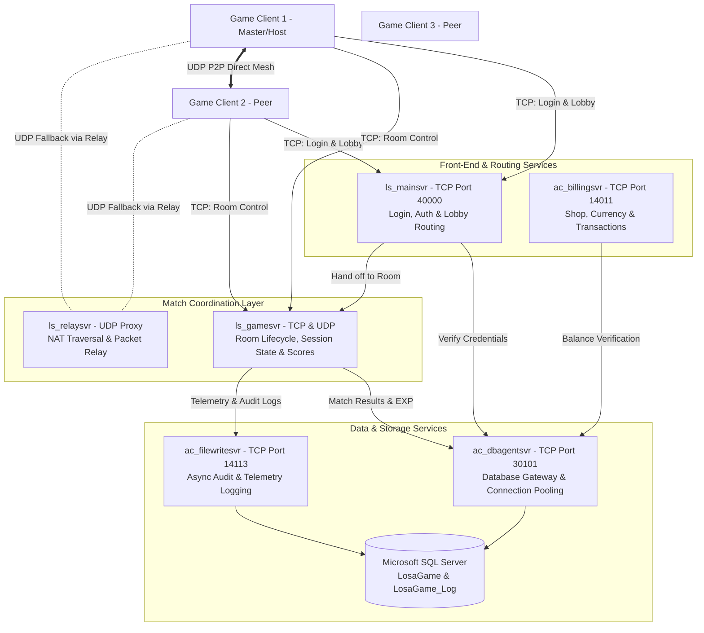
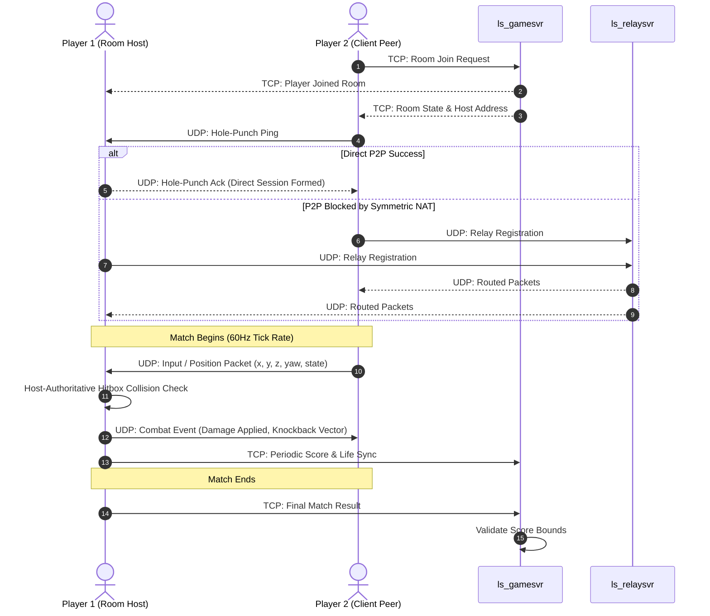

# Multiplayer & Backend Architecture Audit: NOVERA Legacy

## 1. Microservices Topology & Daemon Hierarchy

The Lost Saga multiplayer backend is designed around a multi-process, distributed Windows service architecture. Rather than a single monolithic game server, responsibilities are segmented across specialized daemons communicating via TCP/IP and UDP sockets.



---

## 2. Server Daemon Roles & Responsibilities

| Daemon Name | Protocol & Default Port | Core Responsibilities |
| :--- | :--- | :--- |
| **`ls_mainsvr`** | TCP: `40000` | User authentication, token validation, lobby channel listings, guild listings, global chat channels, and directing clients to available game servers. |
| **`ls_gamesvr`** | TCP / UDP (Dynamic) | Room lifecycle management, slot assignments, game mode rules (Deathmatch, Team Deathmatch, Boss Raid, Prisoner), match phase transitions, and final result submission. |
| **`ls_relaysvr`** | UDP: Dynamic range | Acts as a STUN/TURN proxy for peer clients with symmetric NAT or firewalls that cannot form direct P2P socket pairs. |
| **`ac_dbagentsvr`** | TCP: `30101` (Game) / `30102` (Log) | High-throughput connection pooler to Microsoft SQL Server; deserializes client queries and executes stored procedures asynchronously. |
| **`ac_billingsvr`** | TCP: `14011` | Manages player cash, pesos (game gold), hero purchasing, gashapon rolls, item expiration timers, and transaction idempotency. |
| **`ac_filewritesvr`** | TCP: `14113` | Asynchronous file-based logging daemon that decouples high-volume disk I/O (combat events, item drops, anticheat triggers) from core game logic. |

---

## 3. Network Protocol Specification (`CPacket` / `SP2Packet`)

### 3.1 Packet Wire Frame Header (16 Bytes)
Every network packet exchanged between client and server follows a strict 16-byte binary header:

```text
 0                   1                   2                   3
 0 1 2 3 4 5 6 7 8 9 0 1 2 3 4 5 6 7 8 9 0 1 2 3 4 5 6 7 8 9 0 1
+-+-+-+-+-+-+-+-+-+-+-+-+-+-+-+-+-+-+-+-+-+-+-+-+-+-+-+-+-+-+-+-+
|                       m_ID (Packet Opcode)                    | (4 Bytes)
+-+-+-+-+-+-+-+-+-+-+-+-+-+-+-+-+-+-+-+-+-+-+-+-+-+-+-+-+-+-+-+-+
|                      m_Size (Total Packet Size)               | (4 Bytes)
+-+-+-+-+-+-+-+-+-+-+-+-+-+-+-+-+-+-+-+-+-+-+-+-+-+-+-+-+-+-+-+-+
|                    m_CheckSum (MD5 32-bit Fold)               | (4 Bytes)
+-+-+-+-+-+-+-+-+-+-+-+-+-+-+-+-+-+-+-+-+-+-+-+-+-+-+-+-+-+-+-+-+
|                     m_iState (FSM / Sequence Num)             | (4 Bytes)
+-+-+-+-+-+-+-+-+-+-+-+-+-+-+-+-+-+-+-+-+-+-+-+-+-+-+-+-+-+-+-+-+
|                                                               |
|                        Payload Data                           | (Variable)
|                                                               |
+-+-+-+-+-+-+-+-+-+-+-+-+-+-+-+-+-+-+-+-+-+-+-+-+-+-+-+-+-+-+-+-+
```

### 3.2 Checksum Algorithm
The checksum is calculated over the entire packet with `m_CheckSum` temporarily initialized to 0:
1. Compute MD5 message digest (128 bits) of `Buffer[0..m_Size]`.
2. Fold the four 32-bit words of the MD5 hash using bitwise XOR:
   $$\text{Checksum} = W_0 \oplus W_1 \oplus W_2 \oplus W_3$$
3. Write the 32-bit result into `m_CheckSum`.

### 3.3 Wire Encryption & Stream Obfuscation
Packets transmitted over the wire are obfuscated using a two-stage reversible transformation on all bytes after the checksum address (`Offset 12` through `m_Size`):

```typescript
// Packet byte encryption (Client -> Server)
for (let i = 0; i < length; i++) {
    let b = buffer[i] ^ 0xFF;              // 1. Bitwise Inversion
    const highBits = (b & 0xE0) >> 5;      // 2. Circular 3-bit Rotate Left (ROL 3)
    b = ((b << 3) & 0xFF) | highBits;
    buffer[i] = b;
}

// Packet byte decryption (Server -> Client)
for (let i = 0; i < length; i++) {
    let b = buffer[i];
    const lowBits = (b & 0x07) << 5;       // 1. Circular 3-bit Rotate Right (ROR 3)
    b = (b >> 3) | lowBits;
    b ^= 0xFF;                             // 2. Bitwise Inversion
    buffer[i] = b;
}
```

---

## 4. State Synchronization & Replication Model



### 4.1 Hybrid P2P / Server Coordination
1. **Movement Replication**: Handled via peer-to-peer UDP broadcasts between clients in the same room. Each client broadcasts position, velocity, and current character state ~20-30 times per second.
2. **Combat Arbitration (Host-Authoritative P2P)**:
   * The designated room host (Room Master) resolves physical combat interactions, hitbox collisions, and ring-out triggers.
   * Host broadcasts authoritative damage events, stun states, and gear drop spawns to peers.
3. **Server Validation**:
   * `ls_gamesvr` maintains high-level game state (player scores, time limits, rounds won, alive status).
   * Prevents basic score manipulation by validating that round outcomes match expected timer boundaries and kill limits.

---

## 5. Database Schema & Persistence (`MSSQL`)

### 5.1 Primary Database (`LosaGame`)
* **`UserMember`**: Account credentials, user ID, ban status, pesos balance, cash balance, privilege level.
* **`UserChar`**: Mercenaries owned by each user, experience points (EXP), hero level, gender, mastery.
* **`UserItem`**: Equipment inventory, gear upgrade levels (+0 to +30), enchantments, expiration timestamps.
* **`GuildInfo` / `GuildMember`**: Guild names, emblems, ranks, guild war scores, rosters.

### 5.2 Log Database (`LosaGame_Log` & `LosaLogData`)
* **`Log_Login`**: Connection timestamps, IP addresses, hardware fingerprints, disconnection reasons.
* **`Log_ItemTrade`**: Detailed audit trail of item buys, upgrades, deletions, and gashapon rewards.
* **`Log_BattleResult`**: Match duration, participant IDs, kills, deaths, damage dealt, and rewards granted.

---

## 6. Infrastructure & Deployment Requirements

### 6.1 Server Environment
* **Operating System**: Windows Server 2008 R2, 2012 R2, 2016, 2019, or 2022.
* **Database**: Microsoft SQL Server 2008 / 2012 / 2019 Enterprise or Standard.
* **ODBC Driver**: SQL Server Native Client (`sqlncli.msi`).
* **Visual C++ Redistributable**: VC++ 2010 x86 Redistributable (`vcredist_x86.exe`).

### 6.2 Configuration Management (`global_define.ini`)
Server endpoints are statically configured in INI files distributed with each daemon:
```ini
[Main]
1 = 127.0.0.1:40000

[Billing]
max = 1
1 = 127.0.0.1:14011

[DBA_Game]
max = 1
1 = 127.0.0.1:30101

[DBA_Log]
max = 1
1 = 127.0.0.1:30102

[Log]
max = 1
1 = 127.0.0.1:14113
```

---

## 7. Architectural Vulnerabilities & Anticheat Bottlenecks

1. **Host P2P Vulnerability**:
   Because the room master acts as the combat arbiter, malicious room hosts can spoof hitboxes, grant themselves invulnerability, or drop opponents' gear maliciously (Desync / Host Advantage).
2. **Plaintext / Weak Stream Cipher**:
   The `ROL 3 + XOR 0xFF` packet cipher is trivial to break, allowing man-in-the-middle (MITM) packet injection.
3. **Database Injection via INI**:
   Hardcoded or dynamic SQL queries in older `ac_dbagentsvr` revisions are vulnerable to SQL injection if client inputs are insufficiently sanitized.
4. **Relay Server Saturation**:
   In regions with strict carrier-grade NAT (CGNAT), almost all clients fall back to `ls_relaysvr`, leading to high server bandwidth costs and packet jitter.
